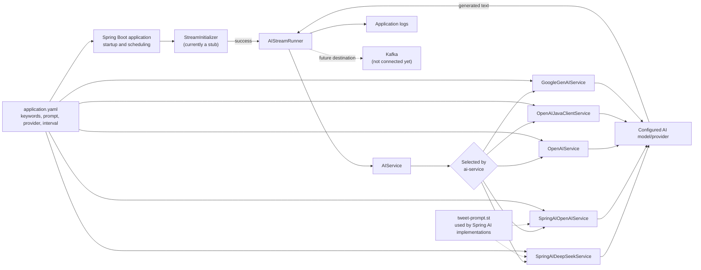
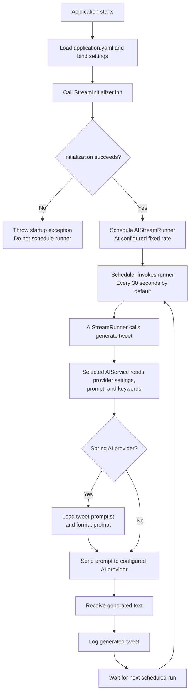

# Microservices Demo

A Java 25 / Spring Boot multi-module project. The current module is an AI-powered tweet generator that periodically asks a configured language model for a tweet containing technology keywords and logs the response.

> **Current scope:** The project is named for a Kafka service, but Kafka publishing is not implemented yet. The stream initializer is currently a stub, and generated tweets are logged rather than sent to Kafka.

## Project structure

```text
.
├── pom.xml
└── ai-generated-tweet-to-kafka-service/
    ├── pom.xml
    └── src/
        ├── main/java/       # Spring Boot application and AI provider integrations
        └── main/resources/  # Provider settings and tweet prompt template
```

The root Maven project aggregates the service module. The service uses Spring AI integrations, the OpenAI Java client, and Google GenAI; `ai-service` selects which implementation is active.

## High-level architecture



`AIService` is the provider boundary: Spring activates the implementation whose `@ConditionalOnProperty` value matches `ai-generated-tweet-to-kafka-service.ai-service`. Only one provider is intended to be active. The default, `SpringAI-DeepSeek`, uses Spring AI's Ollama chat client and the local model configured in `application.yaml`. The Spring AI implementations load `tweet-prompt.st`; the other implementations build a prompt from the configured text and keyword list. Kafka is shown as a future destination only; there is no Kafka client or publishing step in the current flow.

## Functional flow



In practical terms, startup binds configuration, initializes the stream component, and schedules `AIStreamRunner`. On each invocation the runner calls the selected `AIService`; that service creates a prompt using the configured keywords, calls its provider, and returns generated text for logging. A provider or generation failure can interrupt that invocation. The current initializer always reports success, and the runner does not validate, persist, or publish the generated response.

## Requirements

- JDK 25
- Internet access for Maven dependency downloads and any selected hosted AI provider
- Credentials required by the configured AI provider
- For the default `SpringAI-DeepSeek` selection: Ollama running at `http://localhost:11434` with the `deepseek-r1:8b` model available

## Build and test

From the repository root, use the Maven wrapper:

```powershell
.\mvnw.cmd clean verify
```

## Configuration

Application settings are in `ai-generated-tweet-to-kafka-service/src/main/resources/application.yaml`. By default, the service:

- Selects `SpringAI-DeepSeek`
- Generates a tweet every 30 seconds
- Uses the keywords Java, Microservices, Spring, Kafka, and Elasticsearch
- Uses an Ollama model at `localhost:11434` (`deepseek-r1:8b`)

The current configuration references these environment variables: `OPENAI_API_KEY`, `GOOGLE_VERTEX_API_KEY`, and `DEEPSEEK_API_KEY`. Set the appropriate credentials in your environment before starting the application, and never put real keys in source control. For example, in PowerShell:

```powershell
$env:DEEPSEEK_API_KEY = "<your-deepseek-key>"
$env:OPENAI_API_KEY = "<your-openai-key>"
$env:GOOGLE_VERTEX_API_KEY = "<your-google-genai-key>"
```

The `ai-generated-tweet-to-kafka-service.ai-service` property selects a provider implementation. Supported values are:

| Value | Provider implementation | Configuration notes |
|---|---|---|
| `SpringAI-DeepSeek` | Spring AI with the configured Ollama chat model | Default; requires Ollama and the configured local model |
| `SpringAI-OpenAI` | Spring AI OpenAI chat model | Uses the Spring AI OpenAI settings in `application.yaml` |
| `OpenAI` | OpenAI HTTP client integration | Uses the `open-ai` settings in `application.yaml` |
| `OpenAI-JavaClient` | OpenAI Java client | Reads `OPENAI_API_KEY` from the environment |
| `GoogleGenAI` | Google GenAI client | Uses the `google-gen-ai` settings in `application.yaml` |

Change the `ai-service` value in `application.yaml` to select another implementation. Provider model names, generation parameters, prompt, keywords, and scheduler interval can also be adjusted there.

## Run

With the required configuration in place, start the module from the repository root:

```powershell
.\mvnw.cmd -pl ai-generated-tweet-to-kafka-service spring-boot:run
```

The application initializes its stream component, starts the scheduled generator, and writes each generated tweet to the application log. It does not expose a documented HTTP API or publish to a Kafka broker at this time.
